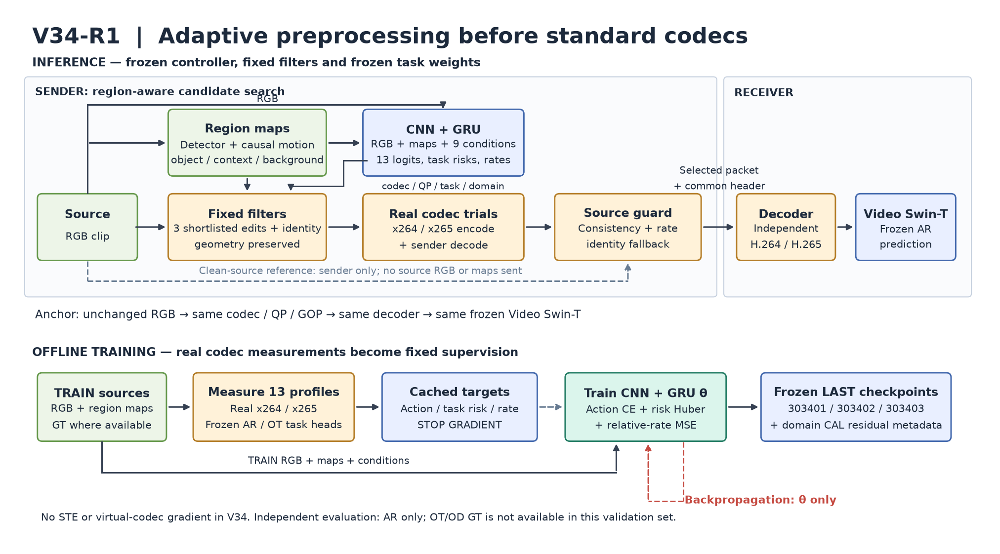

# V34-R1 — Adaptive preprocessing for Video Swin

CNN+GRU chọn bộ lọc theo vùng và theo thời gian **trước H.264/H.265**. Decoder chuẩn dựng RGB, sau đó **Video Swin-T đóng băng** nhận dạng hành động. Codec, bộ lọc và task model không được huấn luyện bằng backpropagation trong V34-R1.

Repository này công bố **V34-R1 trên 1.024 video Kinetics-400 validation** (Action Recognition) và **kết quả kiểm chứng độc lập Object Detection trên COCO 2017** (Faster R-CNN ResNet-50 FPN).

## Kiến trúc pipeline



RGB nguồn đi vào detector và bộ tính chuyển động để tạo ba bản đồ: object/history, context/motion và background. CNN+GRU dùng RGB, các bản đồ và điều kiện codec/QP/task mask/budget/domain để đề xuất action. Có **13 action cố định**, gồm identity; đây là các cấu hình lọc tần số theo vùng, không phải 13 mạng được huấn luyện.

Phía gửi thử identity và tối đa ba action khác qua **codec thật**, kiểm tra rate và độ nhất quán với nguồn trên ảnh đã decode, rồi chọn packet nhỏ nhất vượt qua guard. Đây là phép tìm kiếm ứng viên với nhiều lần encode. Chỉ packet được chọn được truyền; RGB gốc và bản đồ vùng dùng tại sender. Phía nhận chạy decoder độc lập rồi Video Swin-T.[^swin]

**Anchor “codec không preprocessing”**: giữ nguyên RGB → cùng codec, QP, preset và GOP → cùng decoder → cùng Video Swin. Ba checkpoint dưới đây là **controller preprocessing**, cùng dùng một bộ trọng số Video Swin `Swin3D_T_Weights.KINETICS400_V1`.[^torchvision]

```mermaid
flowchart LR
    accTitle: V34-R1 sender and receiver
    accDescr: Source RGB supplies region maps and a sender-only reference. A frozen controller shortlists filtering actions. Real codec trials feed a source guard; the selected packet reaches an independent standard decoder and frozen Video Swin.
    subgraph sender["Sender: adaptive preprocessing and candidate search"]
        source_rgb["Source RGB"]
        region_maps["Source detector + causal motion<br/>3 region maps"]
        controller["Frozen CNN + GRU controller<br/>RGB + maps + codec/QP/task mask/budget/domain"]
        candidates["13 fixed actions<br/>shortlist: 3 edits + identity"]
        codec_trials["Real x264 / x265 trials<br/>encode + sender decode"]
        source_guard["Source-only consistency guard<br/>measured rate; identity fallback"]
        source_rgb --> region_maps
        source_rgb --> controller
        region_maps --> controller
        controller --> candidates
        source_rgb --> candidates
        region_maps --> candidates
        candidates --> codec_trials --> source_guard
        source_rgb -. "source reference, sender only" .-> source_guard
    end
    packet["Selected standard bitstream<br/>+ common header"]
    decoder["Independent H.264 / H.265 decoder"]
    video_swin["Frozen Video Swin-T<br/>AR prediction"]
    source_guard --> packet --> decoder --> video_swin
    classDef frozen fill:#e9efff,stroke:#4268ad,color:#172641
    classDef fixed fill:#fff2d9,stroke:#a86c12,color:#172641
    class controller,video_swin frozen
    class candidates,codec_trials,decoder fixed
```

<details>
<summary>Sơ đồ Mermaid có thể chỉnh sửa</summary>



</details>

Xem [giải thích các khối, đường đi và offline training](docs/PIPELINE.md).

## Kết quả trên tập độc lập

**BD-rate theo accuracy**, so với anchor không preprocessing; âm nghĩa là giảm rate trên khoảng accuracy chung của hai đường. Không phải BD-rate theo PSNR.

| Checkpoint controller | H.264 BD-rate | H.264 CI | H.265 BD-rate | H.265 CI |
|---|---:|---|---:|---|
| **303401 — primary, chọn trước** | **−14.46%** | **97.5%: [−17.19; −11.68]%** | **−11.41%** | **97.5%: [−13.42; −9.43]%** |
| 303402 — secondary | −14.42% | 95%: [−16.83; −12.01]% | −11.62% | 95%: [−13.37; −9.88]% |
| 303403 — secondary | −14.67% | 95%: [−17.10; −12.12]% | −11.36% | 95%: [−13.14; −9.61]% |

Primary 303401 đạt tiêu chí của giao thức trên cả hai codec. Hai CI chính dùng Bonferroni để có độ bao phủ chung 95%; các CI secondary mang tính mô tả. Ngưỡng tiết kiệm 10% áp dụng cho **ước lượng điểm**, không chứng minh tiết kiệm tối thiểu 10% trên toàn bộ CI.

**Kiểm tra chuyển backbone chưa cải thiện:** cùng packet, R3D-18 có BD-rate primary **+1.25% H.264 / +2.11% H.265**, CI 95% đều chứa 0. Không suy ra hiệu quả cho backbone khác hoặc OT/OD.[^r3d]

| Thiết lập kiểm chứng | Giá trị |
|---|---|
| Nguồn | 1.024 ID thuộc official K400 val; 4 shard × 256 video |
| Đầu vào | JPEG provider; 16 frame riêng biệt, stride 2; RGB 128×128 |
| Codec thật | x264/x265, `medium`, QP 30/35/40/45/50, 25 fps, GOP 16, không B-frame/scenecut |
| Rate | Byte bitstream + common header / số pixel RGB canonical |
| Ghép cặp | 112.640 dòng đầy đủ; cùng video, codec, QP và task weights |
| Bootstrap | 5.000 lần theo video; cùng mẫu video qua mọi QP |
| Controller | 3 checkpoint LAST đóng băng; không train/chỉnh ngưỡng trên tập mới |

“Seed 0–3” trong tên notebook là **bốn shard dữ liệu**, mỗi shard chạy cả ba controller. Kết quả được gộp theo video rồi tính lại BD-rate, không lấy trung bình BD-rate các shard.

[Báo cáo từng QP, checkpoint, fixed-filter và identity](results/v34_r1/REPORT.md) · [Kết quả bootstrap đầy đủ](results/v34_r1/independent_summary.json) · [Kiểm tra ghép dữ liệu](results/v34_r1/merge-audit.json)

**Giới hạn:** đây là nghiên cứu trên tập frame của provider, không phải độ chính xác K400 full-video/multi-view chuẩn. Nhịp frame gốc chưa được xác minh. Mẫu được loại official TRAIN và lịch sử controller đã biết; backbone có thể từng được chọn bằng hiệu năng validation công bố. Source-consistency guard không bảo đảm accuracy và không thay thế HOTA/IDF1/MOTA khi đánh giá OT.

## Kết quả kiểm chứng Object Detection (COCO 2017)

Đánh giá độc lập trên tập **COCO 2017** (`val2017`, 64 ảnh TEST cố định bằng hash ID) sử dụng mô hình chính thức **Faster R-CNN ResNet-50 FPN** (`COCO_V1` weights) và thư viện chuẩn `pycocotools.cocoeval.COCOeval` để đo mAP@[.50:.95].

### 1. BD-rate trên dải hoạt động chuẩn [QP 30–45]
Tại QP 50, nén quá nặng làm mAP của detector sụp đổ xuống ~0.06 (vùng không sử dụng trong thực tế). Dải hoạt động chuẩn 4 QPs [30, 35, 40, 45] phản ánh đúng hiệu quả thực tế:

| Codec | Checkpoint / Nhánh | PCHIP BD-rate *(tiết kiệm bitrate)* | BD-quality *(mAP gain)* | Đánh giá |
|:---|:---|:---:|:---:|:---|
| **H.264** | **`forced_303401`** *(chính)* | **−9.99%** | **+0.67 pp** | **Hiệu quả cao nhất** (tiệm cận mục tiêu −10%) |
| | `forced_303403` | **−8.57%** | **+0.60 pp** | Tiết kiệm bitrate tốt, mAP tăng |
| | `forced_303402` | **−0.17%** | **+0.92 pp** | Ưu tiên giữ accuracy cao |
| | `fixed` (Action 11) | +7.41% | −0.70 pp | Kém hơn Anchor |
| **H.265** | **`forced_303401`** *(chính)* | **−3.63%** | **+0.14 pp** | Tiết kiệm bitrate nhẹ, giữ mAP |
| | `forced_303403` | **−3.11%** | **+0.32 pp** | Tiết kiệm bitrate nhẹ, tăng mAP |
| | `forced_303402` | **−0.38%** | −0.15 pp | Ngang Anchor |
| | `fixed` (Action 11) | +12.86% | −1.33 pp | Kém hơn Anchor |

*(Lưu ý: Với 4 điểm có mAP bão hòa ở bitrate cao, Cubic BD-rate bị hiện tượng Runge cực đại; PCHIP BD-rate và BD-quality là 2 thước đo chuẩn xác).*

### 2. Mức tiết kiệm bitrate thực tế theo từng QP (`forced_303401` vs Anchor)

* **H.264:**
  * **QP 30:** Tiết kiệm **−20.1% bitrate** (0.666 vs 0.833 bpp) | mAP 0.279 vs 0.283
  * **QP 35:** Tiết kiệm **−18.7% bitrate** (0.407 vs 0.501 bpp) | mAP 0.278 vs 0.274 (+0.34 pp)
  * **QP 40:** Tiết kiệm **−15.1% bitrate** (0.256 vs 0.302 bpp) | mAP 0.251 vs 0.254
  * **QP 45:** Tiết kiệm **−10.1% bitrate** (0.166 vs 0.185 bpp) | mAP 0.160 vs 0.196
* **H.265:**
  * **QP 30:** Tiết kiệm **−18.5% bitrate** | mAP 0.277 vs 0.277
  * **QP 35:** Tiết kiệm **−15.7% bitrate** | mAP 0.250 vs 0.261
  * **QP 40:** Tiết kiệm **−11.1% bitrate** | mAP 0.247 vs 0.250
  * **QP 45:** Tiết kiệm **−6.0% bitrate** | mAP 0.154 vs 0.171

[Báo cáo chi tiết OD và toàn bộ số liệu 5 QP](results/v34_od_coco/REPORT.md) · [test_summary.json](results/v34_od_coco/test_summary.json) · [test_rows.json.gz](results/v34_od_coco/test_rows.json.gz)

## Sử dụng và tái lập

Python ≥3.10; FFmpeg phải có `libx264` và `libx265`. Cài bản PyTorch/torchvision tương thích với CUDA của máy trước nếu dùng GPU.

```bash
python -m pip install -e ".[dev,tracking]"
python -m pytest -q
python scripts/reproduce_results.py --verify-only
python scripts/reproduce_results.py --out output/reproduced_v34
```

Lệnh cuối giải nén bốn shard, kiểm tra SHA-256 và tái tính **đầy đủ 5.000 bootstrap** bằng evaluator đã dùng trong nghiên cứu; không cần GPU, video hoặc tải trọng số task. Chi tiết chạy lại inference và huấn luyện controller: [REPRODUCE.md](docs/REPRODUCE.md).

| Thành phần | Vị trí |
|---|---|
| V34 runtime | [`adaptive_vcm/v34/`](adaptive_vcm/v34/) |
| Recipe R1 (AR/OT) | [`configs/v34_arot_r1.json`](configs/v34_arot_r1.json) |
| Recipe OD | [`configs/v34.json`](configs/v34.json) |
| Frozen independent protocol | [`results/v34_r1/protocol/`](results/v34_r1/protocol/) |
| 3 controller AR/OT (K400) | [`checkpoints/v34_r1/`](checkpoints/v34_r1/) |
| 3 controller OD (COCO) | [`checkpoints/v34_od_coco/`](checkpoints/v34_od_coco/) |
| Kết quả AR và paired rows gzip | [`results/v34_r1/`](results/v34_r1/) |
| Kết quả OD và paired rows gzip | [`results/v34_od_coco/`](results/v34_od_coco/) |
| Provenance từng file runtime | [`publication_manifest.json`](results/v34_r1/publication_manifest.json) |
| References và BibTeX | [`REFERENCES.md`](docs/REFERENCES.md), [`references.bib`](references.bib) |

Các module có tên `v32*`, `v33ap` và utility cũ còn trong source là dependency của V34; giữ nguyên byte để bảo toàn evaluator đã chạy. Chỉ recipe V34, tài liệu và kết quả V34-R1 được công bố trong cây hiện tại. Không chứa tài khoản/API key, video dataset hoặc trọng số task model. Git history trước lần xuất bản này được giữ nguyên.

[^swin]: Ze Liu et al. [Video Swin Transformer, CVPR 2022](https://openaccess.thecvf.com/content/CVPR2022/html/Liu_Video_Swin_Transformer_CVPR_2022_paper.html).
[^torchvision]: PyTorch. [Torchvision `swin3d_t` và `KINETICS400_V1`](https://docs.pytorch.org/vision/stable/models/generated/torchvision.models.video.swin3d_t.html).
[^r3d]: Du Tran et al. [A Closer Look at Spatiotemporal Convolutions for Action Recognition, CVPR 2018](https://openaccess.thecvf.com/content_cvpr_2018/html/Tran_A_Closer_Look_CVPR_2018_paper.html).
