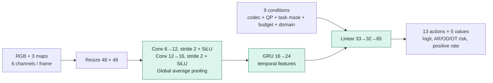

# V34-R1 — các khối và đường đi

[Ảnh kiến trúc](figures/v34_pipeline.png) và [README](../README.md) mô tả pipeline đã chạy. Diagram tách inference với offline training: real codec tạo số đo cố định, CNN+GRU học cách chọn preprocessing.

## 1. Nguồn và ba bản đồ vùng

RGB nguồn đi vào Faster R-CNN ResNet-50 đóng băng và chuyển động giữa hai frame liên tiếp. `region_maps()` tạo object/history, context/motion và background, có tổng trọng số bằng 1 tại mỗi pixel. Object history giảm theo hệ số 0.7; scene cut xóa lịch sử. Không lấy union với các frame tương lai.

Maps phục vụ controller và bộ lọc tại sender. Chúng không được truyền và receiver không cần detector để đảo phép biến đổi.

## 2. Controller CNN+GRU



R1 có **8.661 tham số**, input điều kiện dài 9: codec (1), QP (1), task mask AR/OD/OT (3), budget ratio (1), domain AR/OD/OT (3). Default `Controller(..., conditions=6)` tồn tại để tương thích recipe cơ sở; ba checkpoint công bố dùng **9**, theo `domain_condition=true` trong R1.

Controller không trực tiếp sinh RGB bằng một mạng restoration. Nó dự đoán action và rate/risk; bộ lọc RGB là toán tử cố định theo action được chọn. Risk cho task không hoạt động không tham gia loss/guard.

## 3. Mười ba profile lọc cố định

Một profile/action là **sáu hệ số**, gồm hai hệ số cho mỗi vùng object/context/background. Profile 0 giữ nguyên RGB. Với hai Gaussian cố định `G0.8` và `G1.6`, bộ lọc tính:

```text
H = x - G0.8(x)
M = G0.8(x) - G1.6(x)
y = round_uint8(clip(x + a_H * H + a_M * M, 0, 255))
```

`a_H` và `a_M` được trộn theo ba region maps. Hệ số hữu hạn nằm trong [−0.75, +0.25], điều chỉnh giảm/tăng hai dải tần theo vùng. Không có downscale/retarget/warp; kích thước và tọa độ ảnh không đổi. Danh sách chính xác: [`ACTIONS`](../adaptive_vcm/v34/protocol.py).

## 4. Codec thật và source guard tại sender

Controller tạo shortlist ba action khác identity. Sender encode/decode identity và shortlist bằng x264/x265 cùng cấu hình. Guard kiểm tra **excess source cost so với decoded identity**, không so accuracy với nhãn TEST. AR dùng KL + feature distance của Swin; OT dùng nhất quán với source tracks. Giới hạn R1 là 0.025 cho AR và 0.05 cho OT. Packet phải có byte ratio ≤1.01 so với identity; chọn packet nhỏ nhất trong số hợp lệ.

Đường **clean source** chỉ đi từ nguồn đến frozen teacher và phép kiểm tra tại sender; không đi xuyên mạng vào decoder. Chọn theo source consistency không bảo đảm từng video nhận dạng đúng. Ngưỡng 1.01 cho phép một số packet lớn hơn identity tối đa 1%; việc mean rate cùng QP giảm là **kết quả đo**, không phải ràng buộc ≤1 cho mọi video.

Trong `selected` R1, real source guard quyết định cuối cùng; action từ CAL bounds được ghi lại như diagnostic/ablation, không được hiểu là lớp veto bắt buộc trước source guard. Thử ứng viên, frozen detector/teachers và tracking tại sender có chi phí; số tham số controller nhỏ không đồng nghĩa toàn pipeline rẻ hoặc realtime.

## 5. Bitstream, decoder và task sau decode

Receiver lấy standard bitstream và common packet header, decode độc lập thành RGB. Nó không cần controller, maps hoặc clean source. Frozen Video Swin-T thực hiện AR; R3D-18 đo chuyển backbone trên cùng packet.

Khung AR+OT còn có detector + `supervision==0.27.0` ByteTrack. Nghiên cứu độc lập công bố ở đây có nhãn AR (K400) và kết quả kiểm chứng OD độc lập trên COCO 2017 (Faster R-CNN). OT trên K400 sử dụng source consistency, **không phải** HOTA/IDF1/MOTA xác minh.

## 6. Offline training và backpropagation

```mermaid
flowchart LR
    accTitle: Offline training from real codec measurements
    accDescr: Training sources and fixed profiles pass through real codecs and frozen task heads to produce cached targets. Stop gradient targets supervise a trainable CNN GRU controller. Only its parameters receive optimizer updates. CAL residuals produce checkpoint metadata without further gradient updates.
    train_sources["TRAIN RGB + region maps"] --> profiles["All 13 fixed profiles"]
    profiles --> real_codec["Real x264/x265<br/>all frozen QP conditions"]
    real_codec --> task_measure["Frozen task heads<br/>measured bytes + task cost"]
    task_measure --> cache["Cached action / risk / rate targets<br/>STOP GRADIENT"]
    train_sources --> train_controller["Trainable CNN + GRU θ"]
    train_controller --> loss["CE(action) + 4×masked risk loss<br/>+ 4×rate MSE"]
    cache -. "supervision only" .-> loss
    loss -. "backpropagation: ∂L/∂θ" .-> train_controller
    train_controller --> checkpoint["LAST checkpoint + CAL residuals<br/>freeze for independent inference"]
    classDef learned fill:#dbf5ec,stroke:#247d65,color:#142d26
    classDef fixed fill:#e9efff,stroke:#4268ad,color:#172641
    class train_controller learned
    class profiles,real_codec,task_measure,cache fixed
```



1. Duyệt profile bằng codec thật trên TRAIN/CAL, cache measured relative bytes và task-cost deltas so với identity. Nhãn GT được dùng trên domain có GT; domain khác dùng source consistency, được ghi riêng bằng mask/provenance.
2. Tạo action target bằng rate + 0.25×mean active damage trong các action thỏa damage tolerance và budget. `target` là nhãn cố định cho controller.
3. Adam cập nhật **θ của CNN+GRU**, 30 epoch, learning rate 0.001. R1 dùng masked **Smooth L1/Huber risk loss sau chia task scale 0.05**, action cross entropy và relative-rate MSE; gradient norm bị chặn ở 5.
4. CAL lấy one-sided residual theo domain, không cập nhật θ. Dữ liệu QP/window tương quan; đây là empirical calibration, không bảo đảm coverage khi domain đổi.
5. Đóng băng checkpoint LAST; tập độc lập không train/recalibrate/chọn lại primary.

**No gradient** nghĩa là target/cache và frozen task/codec không nhận gradient optimizer. V34-R1 không cần STE và không backprop qua H.264/H.265: real codec đã chạy trước để tạo bảng supervision. Các module virtual codec còn được import gián tiếp như utility dependency, không nằm trên training path V34.
